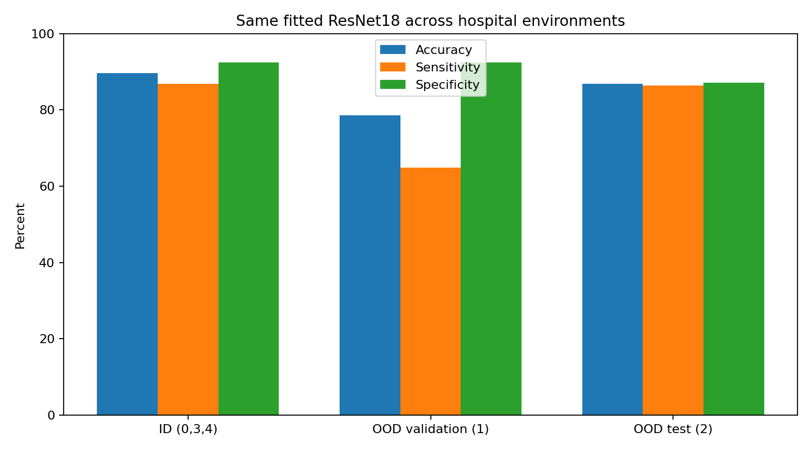
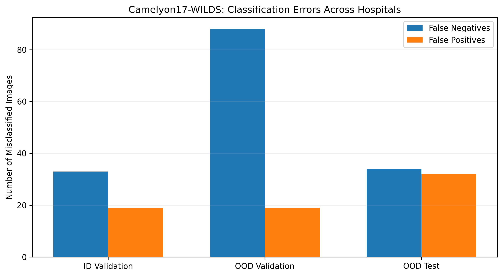

# Study

**Article:** WILDS: A Benchmark of in-the-Wild Distribution Shifts

**Authors:** Pang Wei Koh et al. (2021)

**DOI/URL:** https://proceedings.mlr.press/v139/koh21a.html

**Replication Type:** Partial

**Computational Environment:** Python 3.13.16, Google Colab, NVIDIA Tesla T4 GPU

**Primary Packages:** PyTorch, torchvision, Hugging Face Datasets, scikit-learn, NumPy, pandas, Matplotlib

**Random Seed:** 735

**Repository:** Original study: https://github.com/p-lambda/wilds (personal replication repository not yet provided)

# 1. Research Claim

The main finding I am examining from Koh et al. [@koh2021wilds] is that a predictive model can perform well on data similar to its training environment but become less reliable when evaluated under a different distribution. The authors demonstrated this problem across several real-world datasets, including Camelyon17-WILDS, where pathology images come from different hospitals. The task is to classify image patches according to whether they contain tumor tissue. Model performance is evaluated primarily through classification accuracy across in-distribution and out-of-distribution environments.

I selected this finding because a model's performance in its development environment does not necessarily tell us how well it will perform elsewhere. In this replication, I examine whether the same trained classifier produces different results when evaluated on images from hospitals that were excluded from training.

# 2. Replication Strategy

I approached this study as a partial replication because I could access the Camelyon17-WILDS dataset and reproduce its hospital-based evaluation structure, but not the full experimental setup used by Koh et al. [@koh2021wilds]. I initially attempted to obtain the dataset through the official source but encountered an SSL-related download problem. I therefore used a publicly available Hugging Face mirror and streamed the image records into Google Colab.

To keep the experiment manageable, I selected 3,500 image patches across the training, in-distribution validation, and two out-of-distribution evaluation environments. I also used an ImageNet-pretrained ResNet18 model with a frozen feature extractor rather than reproducing the original training procedure. Although these decisions prevent a direct numerical comparison with the published benchmark, they allow me to examine the central question: whether a classifier trained on images from certain hospitals performs differently when evaluated at previously unseen hospitals.

# 3. Data

I used the Camelyon17-WILDS dataset, accessed through a publicly available Hugging Face mirror. The dataset contains digitized pathology image patches collected from five hospitals. Each image patch represents one observation, with a binary label indicating whether tumor tissue is present. The image pixels serve as the model's input features, while hospital identifiers define the evaluation environments.

I selected 3,500 patches: 2,000 for training from hospitals 0, 3, and 4; 500 for in-distribution validation from the same hospitals; 500 for out-of-distribution validation from hospital 1; and 500 for out-of-distribution testing from hospital 2. Each split was deliberately balanced between tumor and non-tumor images. I resized the original 96 × 96 images to 224 × 224 and applied ImageNet normalization. This reduced, class-balanced sample differs from the full benchmark and does not represent the natural prevalence of tumor tissue.

# 4. Method

I used an ImageNet-pretrained ResNet18 model to classify pathology image patches as tumor or non-tumor. Rather than retraining the entire network, I froze the pretrained feature extractor and replaced the final classification layer with a two-class output layer. This allowed me to examine the effect of hospital distribution shift without the computational demands of full model training.

The model was trained on 2,000 balanced images from hospitals 0, 3, and 4 using the Adam optimizer, a learning rate of 0.001, cross-entropy loss, and a batch size of 32. Training lasted five epochs on a Tesla T4 GPU in Google Colab. I used random seed 735 and kept the BatchNorm running statistics fixed during training.

After training, I evaluated the same fitted model on three separate environments: in-distribution validation, out-of-distribution validation at hospital 1, and out-of-distribution testing at hospital 2. I measured accuracy, precision, sensitivity, specificity, F1 score, and Brier score, alongside false-positive and false-negative counts. The analysis was conducted in Python using PyTorch, torchvision, Hugging Face Datasets, scikit-learn, NumPy, pandas, and Matplotlib.

# 5. Results

| Metric | ID validation | OOD center 1 | OOD center 2 |
|---|---:|---:|---:|
| Accuracy | 89.6% | 78.6% | 86.8% |
| Precision | 91.95% | 89.50% | 87.10% |
| Sensitivity | 86.8% | 64.8% | 86.4% |
| Specificity | 92.4% | 92.4% | 87.2% |
| F1 score | 0.8930 | 0.7517 | 0.8675 |
| Brier score | 0.0780 | 0.1577 | 0.1052 |
| False negatives | 33 | 88 | 34 |
| False positives | 19 | 19 | 32 |

The results show that the same trained classifier performed differently across the three evaluation environments. Accuracy was highest on the in-distribution validation set at 89.6%, compared with 78.6% at hospital 1 and 86.8% at hospital 2. The largest difference was in sensitivity, which declined from 86.8% in the ID environment to 64.8% at hospital 1. This means the model missed 88 of the 250 tumor-positive patches at that hospital, compared with 33 in the ID set.

Hospital 2 showed a smaller decline in accuracy, although its specificity was lower than that of hospital 1. Brier scores were also higher in both OOD environments, indicating poorer probability prediction quality. These findings support the concern that performance measured in one environment may not reliably represent performance elsewhere, although the sampling design and slide-level overlap in ID validation limit how confidently the differences can be attributed to hospital shift alone.

*Figure 1. Accuracy, sensitivity, and specificity across the evaluation environments.*

*Figure 2. False-positive and false-negative counts in ID validation, OOD validation (center 1), and OOD test (center 2).*

# 6. Compare

| Evidence | Original WILDS benchmark | My partial replication |
|---|---:|---:|
| ID validation accuracy | ~93.2% | 89.6% |
| OOD validation accuracy | ~84.9% | 78.6% |
| OOD test accuracy | ~70.3% | 86.8% |
| ID-to-OOD validation decline | ~8.3 percentage points | 11.0 percentage points |

*Note: The original figures refer to the published ERM baseline. Differences in training procedures, sampling, and class balance prevent direct numerical equivalence.*

My results were consistent with the broader finding reported by Koh et al. [@koh2021wilds]: performance measured on familiar data did not fully carry over to an unseen hospital. In the original WILDS benchmark, the reported ERM baseline achieved approximately 93.2% accuracy on ID validation, 84.9% on OOD validation, and 70.3% on OOD testing. My experiment produced 89.6%, 78.6%, and 86.8%, respectively.

The direction of the ID-to-OOD validation decline was similar, although the size differed. My model lost 11 percentage points in accuracy at hospital 1, compared with approximately 8.3 points in the published baseline. However, the higher OOD test accuracy in my experiment should not be interpreted as an improvement over the original study. I used only 3,500 deliberately balanced image patches and trained a frozen ResNet18 feature extractor rather than following the original training procedure.

I also found 30 slide identifiers shared between training and ID validation, creating possible optimism in the ID result. The two OOD evaluation sets had no overlapping slide identifiers with training. Taken together, the findings provide a useful partial reproduction of the distribution-shift concern, but the numerical results are not directly equivalent to those reported in WILDS.

# 7. Reproducibility Check

- [x] Data source documented
- [x] Code runs from beginning to end
- [x] Computational environment identified
- [x] Software/packages documented
- [x] Package versions documented
- [x] Random seed documented
- [x] Key preprocessing steps documented
- [x] Evaluation procedure documented
- [ ] Repository README provides reproduction instructions

**What was the greatest reproducibility challenge you encountered?**

My greatest challenge was maintaining a consistent evaluation procedure while working with a reduced sample of the original dataset. The official download initially failed, requiring me to use a streamed dataset mirror. Although I fixed the random seed at 735, the two runs produced slightly different results. For example, OOD test accuracy changed from 83.2% to 86.8%. I also discovered that training and ID validation shared 30 unique slide identifiers, creating a possible source of optimistic validation performance. These findings showed me that documenting a random seed is not enough; sample identity and evaluation independence also matter.

# 8. Extend

One extension I would pursue is to repeat the evaluation using strictly slide-disjoint training and validation samples. During my analysis, I found that 30 unique slide identifiers appeared in both the training and ID validation sets. Although the image patches were sampled separately, patches originating from the same pathology slide may share characteristics that make classification easier. This raises questions about whether the ID validation accuracy provides an independent assessment of model performance.

I would reorganize the sampling procedure so that all patches from a given slide belong to only one split, while retaining the hospital-based OOD evaluation. I would then retrain the same ResNet18 classifier and compare its performance with my current results. This would help determine how much of the observed ID-to-OOD performance difference remains after controlling for slide-level overlap.

# Replication Verdict

- [ ] **Reproduced**
- [x] **Partially Reproduced**
- [ ] **Not Reproduced**
- [ ] **Not Directly Comparable**

My experiment reproduced the general finding that a model's performance can deteriorate when evaluated on data from an unseen hospital. However, the reduced and deliberately balanced sample, differences in model training, and overlap between training and ID validation slides prevent me from claiming that I reproduced the original benchmark results. The findings therefore support a partial reproduction of the distribution-shift concern rather than an exact replication of the published results.

# References

::: {#refs}
:::
